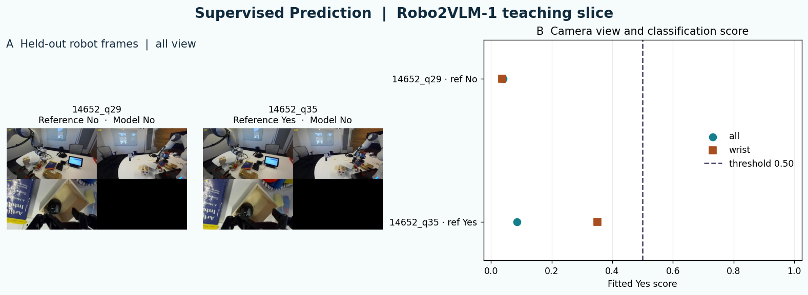

# 03 Prediction · STATS 201 Week 3

**Executive summary.** Can a model recognize task completion in a camera frame from a robot run it has never seen? This lab turns pixels into features, trains logistic regression on other runs and checks two predictions against the recorded answers. You learn to separate a score from a decision, recognize a missed completion and ask how camera position changes the evidence. Similar questions arise when using images to inspect buildings, crops or wildlife.

[Open 03 Prediction in Colab](https://colab.research.google.com/github/sunshineluyao/ml4ss/blob/main/modules/03-prediction/week03_03_robot_prediction.ipynb)

## Learning objectives

- Explain how the notebook turns an image into features for a supervised classifier.
- Describe why related observations are held out together when testing a prediction.
- Compare model scores, thresholded labels, reference labels and a baseline.

## Terms to know

| Term | Meaning in this lab |
|---|---|
| Trajectory | A complete recorded robot run. Multiple observations can come from one trajectory. |
| Feature and label | A feature is a numeric image input. The label is the decoded Yes or No answer used to teach or check the classifier. |
| Yes score | The fitted classifier's estimated probability of the Yes class for one frame. |
| Threshold | The cutoff that converts a score into a decision. The default calls Yes at 0.50 or higher. |
| False negative | The model calls No when the reference says Yes. |
| Baseline | A simple prediction rule for comparison. Here it always calls No, the majority training label. |

## Code cell walkthrough

### Cell 1 · Set up the images and prediction tools (`setup`)

Imagine inspecting the same crop from a drone and from ground level. Both pictures describe the same site, but each camera makes different details visible. The code sets the public data source and target frame IDs. It prepares Pillow for handling the images, NumPy for arranging pixel values and scikit-learn for fitting logistic regression. These tools let the next cells make the data, feature and decision choices separately.

<details>
<summary>Code from this cell</summary>

```python
# Read and run. The data loader makes public Hugging Face requests.

import json
import time
from io import BytesIO
from urllib.error import HTTPError, URLError
from urllib.parse import urlencode
from urllib.request import urlopen

import matplotlib.pyplot as plt
import pandas as pd
from IPython.display import Image as NotebookImage, display

import ast
from collections import Counter
from concurrent.futures import ThreadPoolExecutor

import numpy as np
from PIL import Image
from sklearn.linear_model import LogisticRegression
from threadpoolctl import threadpool_limits

DATA_SERVER = "https://datasets-server.huggingface.co"
ROBOT = "keplerccc/Robo2VLM-1"
TARGET_IDS = ("14652_q29", "14652_q35")

def read_url(url):
    for attempt in range(5):
        try:
            with urlopen(url, timeout=25) as response:
                return response.read()
        except (URLError, TimeoutError) as error:
            if isinstance(error, HTTPError) and error.code not in {429, 500, 502, 503, 504}:
                raise RuntimeError(f"Hugging Face returned HTTP {error.code}. Rerun the data cell.") from error
            if attempt == 4:
                raise RuntimeError("Hugging Face is unavailable. The saved default outputs can support discussion.") from error
            time.sleep(2 ** attempt)

def page(dataset, offset=0, first=False):
    params = {"dataset": dataset, "config": "default", "split": "train"}
    endpoint = "first-rows" if first else "rows"
    if not first:
        params.update(offset=offset, length=100)
    return json.loads(read_url(f"{DATA_SERVER}/{endpoint}?{urlencode(params)}"))["rows"]

def show_figure(fig):
    buffer = BytesIO()
    fig.savefig(buffer, format="png", dpi=125, bbox_inches="tight")
    plt.close(fig)
    display(NotebookImage(data=buffer.getvalue()))
```

</details>

### Cell 2 · Build the training and test sets (`robot-data`)

A model tested on one photo of a site can benefit from having seen nearby photos of that same site. The code groups robot observations by trajectory so it can set aside the entire run `14652`. It decodes each row's answer and keeps the Yes or No completion questions from other trajectories for training. It downloads images only for the selected training rows and the two test frames.

<details>
<summary>Code from this cell</summary>

```python
# Read and run. Each row has its own choice order.
def reference_answer(row):
    choices = row["choices"]
    choices = ast.literal_eval(choices) if isinstance(choices, str) else choices
    return choices[row["correct_answer"]]

first_robot = [entry["row"] for entry in page(ROBOT, first=True)]
targets = [next(row for row in first_robot if row["id"].endswith(key)) for key in TARGET_IDS]

# Read and run once. Download only the filtered training images and the two test images.
def load_robot_page(offset):
    return first_robot if offset == 0 else [item["row"] for item in page(ROBOT, offset)]

def trajectory(row):
    return row["id"].rsplit("_q", 1)[0]

def image_from_row(row):
    with Image.open(BytesIO(read_url(row["image"]["src"]))) as img:
        return img.convert("RGB")

with ThreadPoolExecutor(max_workers=2) as pool:
    rows = [row for batch in pool.map(load_robot_page, range(0, 600, 100)) for row in batch]
held_out = trajectory(targets[0])
assert all(trajectory(row) == held_out for row in targets)

training = [row for row in rows
            if trajectory(row) != held_out
            and row["question"].endswith("Has the robot successfully completed the task?")
            and reference_answer(row) in {"Yes", "No"}]
training_labels = [reference_answer(row) for row in training]
with ThreadPoolExecutor(max_workers=4) as pool:
    train_images = list(pool.map(image_from_row, training))
    test_images = list(pool.map(image_from_row, targets))

print(f"Rows read: {len(rows)}")
print(f"Training: {len(training)} labelled images from {len({trajectory(row) for row in training})} other trajectories")
print(f"Training labels: {dict(sorted(Counter(training_labels).items()))}")
print(f"Held-out trajectory: {held_out.rsplit('_', 1)[-1]}")
```

</details>

| Quantity printed in the saved run | Value |
|---|---:|
| Source rows read | 600 |
| Labeled training images | 94 |
| Other trajectories contributing training images | 16 |
| Training labels No / Yes | 79 / 15 |
| Held-out trajectory | 14652 |

### Cell 3 · Convert pixels to scores (`robot-fit`)

`camera_view` selects the full camera montage (`VIEW = "all"`) or the lower-left wrist crop (`VIEW = "wrist"`). Each chosen view is resized to 24 × 14 pixels. The three color channels give 1,008 input numbers scaled between 0 and 1. The classifier learns weights from the training images and labels. Balanced class weights give the less common Yes training examples more influence per row. `predict_proba` returns scores for the test images and `THRESHOLD` converts them to labels.

<details>
<summary>Code from this cell</summary>

```python
# Your turn · change one setting after the default run.
VIEW = "all"  # "all" or "wrist"
THRESHOLD = 0.50  # a number strictly between 0 and 1
assert 0 < THRESHOLD < 1

def camera_view(img, view):
    if view == "all":
        return img
    if view == "wrist":
        width, height = img.size
        return img.crop((0, height // 2, width // 2, height))
    raise ValueError('Choose VIEW = "all" or VIEW = "wrist".')

def pixels(img, view):
    thumbnail = camera_view(img, view).resize((24, 14), Image.Resampling.BILINEAR)
    return np.asarray(thumbnail, dtype=np.float32).ravel() / 255

def fit_camera(view):
    x_train = np.stack([pixels(img, view) for img in train_images])
    x_test = np.stack([pixels(img, view) for img in test_images])
    labels = np.array([answer == "Yes" for answer in training_labels], dtype=int)
    classifier = LogisticRegression(C=1.0, class_weight="balanced", max_iter=1000, random_state=0)
    with threadpool_limits(limits=1):
        classifier.fit(x_train, labels)
    yes_scores = classifier.predict_proba(x_test)[:, list(classifier.classes_).index(1)]
    return x_train, x_test, labels, classifier, yes_scores

X_train, X_test, y_train, model, scores = fit_camera(VIEW)
predictions = np.where(scores >= THRESHOLD, "Yes", "No")
```

</details>

```python
VIEW = "all"
THRESHOLD = 0.50
predictions = np.where(scores >= THRESHOLD, "Yes", "No")
```

### Cell 4 · Check the predictions against references (`robot-out`)

The output aligns each prediction with the reference and the always-No baseline. Think of a monitoring system where overlooking completion and signaling it too early have different consequences. Read each error against what the system was meant to detect.

<details>
<summary>Code from this cell</summary>

```python
# Read and run. Compare the chosen view with the baseline and the reference.
references = [reference_answer(row) for row in targets]
result = pd.DataFrame({
    "Frame": TARGET_IDS,
    "Yes score": np.round(scores, 3),
    "Prediction": predictions,
    "Reference": references,
    "Baseline": ["No"] * len(TARGET_IDS),
})
result["Matches reference"] = result["Prediction"] == result["Reference"]
display(result)
```

</details>

| Frame | Yes score | Prediction | Reference | Always-No baseline |
|---|---:|---|---|---|
| 14652_q29 | 0.040 | No | No | No |
| 14652_q35 | 0.086 | No | Yes | No |

At the default cutoff, q35 is a false negative because its score of 0.086 falls below 0.50. The model and baseline each match one of the two references. The two cases support error inspection. A broader performance comparison needs independent trajectories from the setting of interest.

### Cell 5 · See how the camera changes the evidence (`prediction-gallery`)

Panel A shows the two test frames in the selected view. Panel B fits the other view and plots both sets of scores against the same threshold. For q35, the wrist crop raises the score from **0.086** to about **0.350**. Both scores fall below 0.50. A camera can change a score even when the reported decision stays the same.

<details>
<summary>Code from this cell</summary>

```python
# Read and run after fitting. This cell makes the two-panel gallery.
def prediction_gallery(filename="STATS201_Week3_Prediction_Gallery.png"):
    alternative = "wrist" if VIEW == "all" else "all"
    by_view = {VIEW: scores, alternative: fit_camera(alternative)[-1]}
    fig = plt.figure(figsize=(12.5, 4.5), layout="constrained", facecolor="#f6fbfb")
    panels = fig.add_gridspec(1, 2, width_ratios=[1.2, 1])
    images = panels[0].subgridspec(2, 2, height_ratios=[.17, 1])
    label = fig.add_subplot(images[0, :])
    label.set_axis_off()
    label.text(0, .45, f"A  Held-out robot frames  |  {VIEW} view",
               fontsize=12, color="#152d40", fontweight="medium")
    axes = [fig.add_subplot(images[1, 0]), fig.add_subplot(images[1, 1])]
    for ax, img, frame, ref, predicted in zip(axes, test_images, TARGET_IDS, references, predictions):
        ax.imshow(camera_view(img, VIEW))
        ax.set_title(f"{frame}\nReference {ref}  ·  Model {predicted}", fontsize=10)
        ax.set_axis_off()

    b = fig.add_subplot(panels[1])
    for view, marker, color in (("all", "o", "#137f8c"), ("wrist", "s", "#a94e1f")):
        b.scatter(by_view[view], [0, 1], marker=marker, color=color, s=64, label=view, zorder=3)
    b.axvline(THRESHOLD, color="#453e63", linestyle="--", label=f"threshold {THRESHOLD:.2f}")
    b.set(xlim=(-.025, 1.025), ylim=(1.27,-.27), yticks=[0,1],
          yticklabels=[f"{frame} · ref {ref}" for frame, ref in zip(TARGET_IDS,references)],
          title="B  Camera view and classification score", xlabel="Fitted Yes score")
    b.grid(axis="x", alpha=.23)
    b.legend(frameon=False, loc="center right")
    fig.suptitle("Supervised Prediction  |  Robo2VLM-1 teaching slice",
                 fontsize=16, color="#102b3d", fontweight="bold")
    if filename:
        fig.savefig(filename, dpi=150, facecolor=fig.get_facecolor(), bbox_inches="tight")
    show_figure(fig)
    return by_view

view_scores = prediction_gallery()
```

</details>



**Try one change.** Set `VIEW = "wrist"` in Cell 3 and rerun Cells 3–5. Compare the images and the Yes score. To explore the decision rule separately, choose a different `THRESHOLD`. Use validation trajectories to set a cutoff for a larger evaluation.

**Transfer question.** If you were predicting crop damage from aerial images, would you hold out individual pictures, fields or seasons? What new cases would your choice represent?

Trace the reference answers in the [01 Measurement walkthrough](../01-measurement/README.md#week-3-measurement). Compare models on matched test folds in the [04 Evaluation walkthrough](../04-evaluation/README.md).

**Source.** [Robo2VLM-1 dataset](https://huggingface.co/datasets/keplerccc/Robo2VLM-1) · [Chen et al., Robo2VLM paper](https://papers.neurips.cc/paper_files/paper/2025/hash/1f467c3e37abf9f86c78f44c6a27ee7c-Abstract-Datasets_and_Benchmarks_Track.html)

