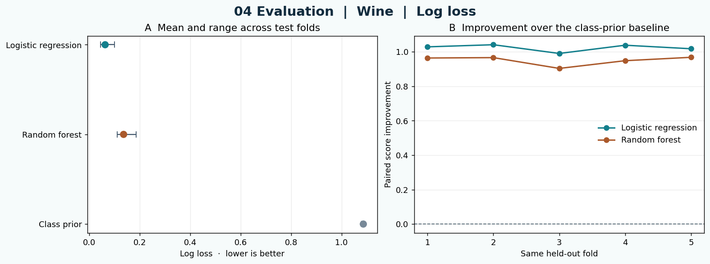

# 04 Evaluation · STATS 201 Week 3

**Executive summary.** Which model performs better when each method faces the same cases? This lab compares a class-prior baseline, logistic regression and random forest on five shared test folds. You learn to choose a scoring rule, read matched differences and explain how a ranking depends on the tasks and metrics included. The classroom experiment uses Wine or Digits data. The TabArena paper provides the benchmark design case.

[Open 04 Evaluation in Colab](https://colab.research.google.com/github/sunshineluyao/ml4ss/blob/main/modules/04-evaluation/week03_04_tabarena_evaluation.ipynb)

## Learning objectives

- Explain how shared training and test splits support a fair comparison.
- Interpret log loss and balanced accuracy using predictions from the same held-out rows.
- Read fold-level differences and propose a benchmark rule for a research question.

## Terms to know

| Term | Meaning in this lab |
|---|---|
| Fold | One held-out group of rows. The model trains on the other groups and is scored on this group. |
| Stratification | Splitting the rows while keeping class proportions as similar as possible across folds. |
| Class-prior baseline | Estimates class probabilities from class frequencies in the training fold and predicts the most frequent class. |
| Log loss | Scores the probability given to the true class. Lower is better. For a single true class, probability 0.8 gives about 0.223 loss and 0.2 gives about 1.609. |
| Balanced accuracy | Averages recall across classes. Higher is better. Each class receives equal weight in this average. |
| Paired improvement | Compares two scores on the same test fold. Positive values favor the classifier over the class-prior baseline. |

## Code cell walkthrough

### Cell 1 · Gather tools for a comparison (`imports`)

Suppose two groups propose ways to classify historical documents. Before comparing them, agree on the data, test cases and scoring rules. This cell imports the two bundled datasets, the baseline and classifiers, the splitter and both scoring functions. The code also imports a pipeline so feature scaling can be learned on training rows within each fold. pandas collects results and Matplotlib draws the comparison.

<details>
<summary>Code from this cell</summary>

```python
# Read and run. The datasets are packaged with scikit-learn.
from io import BytesIO

import matplotlib.pyplot as plt
import numpy as np
import pandas as pd
from IPython.display import Image as InlineImage, display
from sklearn.base import clone
from sklearn.datasets import load_digits, load_wine
from sklearn.dummy import DummyClassifier
from sklearn.ensemble import RandomForestClassifier
from sklearn.linear_model import LogisticRegression
from sklearn.metrics import balanced_accuracy_score, log_loss
from sklearn.model_selection import StratifiedKFold
from sklearn.pipeline import make_pipeline
from sklearn.preprocessing import StandardScaler
from threadpoolctl import threadpool_limits
```

</details>

### Cell 2 · Score three methods on the same held-out rows (`score-folds`)

The default `DATASET = "wine"` has **178 rows**, **13 features** and **3 classes**. Each row is a wine sample. The `"digits"` option has 1,797 rows, 64 pixel features and 10 classes. Each row is one handwritten digit. Here `X` holds the input features and `y` holds the class labels.

<details>
<summary>Code from this cell</summary>

```python
DATASET = "wine"  # "wine" or "digits"
datasets = {"wine": load_wine, "digits": load_digits}
if DATASET not in datasets:
    raise ValueError("Choose wine or digits.")
data = datasets[DATASET]()
X, y = data.data, data.target
classes, counts = np.unique(y, return_counts=True)
print(f"{DATASET.title()} · {len(y)} rows, {X.shape[1]} features, {len(classes)} classes")
print("Rows by class:", dict(zip(classes.tolist(), counts.tolist())))

# Reuse these exact train and test indices for every method.
folds = list(StratifiedKFold(n_splits=5, shuffle=True, random_state=201).split(X, y))
assert sorted(np.concatenate([test for _, test in folds]).tolist()) == list(range(len(y)))
assert all(np.intersect1d(train, test).size == 0 for train, test in folds)

methods = {
    "Class prior": DummyClassifier(strategy="prior"),
    "Logistic regression": make_pipeline(StandardScaler(), LogisticRegression(max_iter=1000, random_state=201)),
    "Random forest": RandomForestClassifier(n_estimators=80, random_state=201, n_jobs=1),
}
records = []
with threadpool_limits(limits=1):
    for fold, (train, test) in enumerate(folds, 1):
        for name, estimator in methods.items():
            model = clone(estimator).fit(X[train], y[train])
            assert np.array_equal(model.classes_, classes)
            records.append({
                "Fold": fold, "Method": name, "Test rows": len(test),
                "log_loss": log_loss(y[test], model.predict_proba(X[test]), labels=classes),
                "balanced_accuracy": balanced_accuracy_score(y[test], model.predict(X[test])),
            })
results = pd.DataFrame(records)
display(results.round(3))
```

</details>

`StratifiedKFold` creates five train/test pairs, reused by all three methods. Each row appears in one test fold. `clone` starts a fresh fit for each method and fold. Scaling for logistic regression is learned inside that fit. Random forest uses 80 trees and the class-prior baseline uses the training class frequencies. The cell collects **15 rows** of results, one per method and fold. This is an example from the saved first Wine fold, in which every method faced the same 36 test rows.

| Method | Test rows | Log loss | Balanced accuracy |
|---|---:|---:|---:|
| Class prior | 36 | 1.090 | 0.333 |
| Logistic regression | 36 | 0.061 | 1.000 |
| Random forest | 36 | 0.126 | 0.976 |

### Cell 3 · Compare means and matched differences (`evaluation-gallery`)

`METRIC = "log_loss"` selects the default view of the results. The code reshapes the table so each method has a score for the same five folds. For log loss, improvement is the baseline loss minus the classifier loss on that fold. In fold 1, the rounded scores give logistic regression an improvement of about `1.090 - 0.061 = 1.029`. For balanced accuracy, improvement is the classifier score minus the baseline score. Positive values favor the classifier with either metric.

<details>
<summary>Code from this cell</summary>

```python
METRIC = "log_loss"  # "log_loss" or "balanced_accuracy"
direction = {"log_loss": -1, "balanced_accuracy": 1}
titles = {"log_loss": "Log loss", "balanced_accuracy": "Balanced accuracy"}
if METRIC not in direction:
    raise ValueError("Choose log_loss or balanced_accuracy.")

paired = results.pivot(index="Fold", columns="Method", values=METRIC)
assert paired.notna().all().all()
summary = pd.DataFrame({"Mean test score": paired.mean(), "Lowest fold": paired.min(),
                        "Highest fold": paired.max(), "Matched folds": paired.count()})
summary = summary.sort_values("Mean test score", ascending=direction[METRIC] == -1)
display(summary.round(3))
improvement = paired.drop(columns="Class prior").sub(paired["Class prior"],axis=0) * direction[METRIC]

fig, (a, b) = plt.subplots(1, 2, figsize=(12, 4.4), layout="constrained", facecolor="#f6fbfb")
colors = {"Class prior":"#788998", "Logistic regression":"#137f8c", "Random forest":"#aa592b"}
labels = summary.index.tolist()
means = summary["Mean test score"].to_numpy()
err = np.stack([means - summary["Lowest fold"], summary["Highest fold"] - means])
a.errorbar(means, labels, xerr=err, fmt="none", color="#40566a", capsize=4, linewidth=1.3)
a.scatter(means, labels, c=[colors[label] for label in labels], s=62, zorder=3)
a.invert_yaxis()
a.set(title="A  Mean and range across test folds",
      xlabel=titles[METRIC] + ("  ·  lower is better" if direction[METRIC] == -1 else "  ·  higher is better"))
a.grid(axis="x", alpha=.25)
for name in improvement:
    b.plot(improvement.index, improvement[name], marker="o", linewidth=1.7, color=colors[name], label=name)
b.axhline(0, color="#536773", linestyle="--", linewidth=1)
b.set(title="B  Improvement over the class-prior baseline",
      xlabel="Same held-out fold", ylabel="Paired score improvement",
      xticks=improvement.index)
b.grid(axis="y", alpha=.23)
b.legend(frameon=False, loc="best")
fig.suptitle(f"04 Evaluation  |  {DATASET.title()}  |  {titles[METRIC]}",
             fontsize=16, fontweight="bold", color="#102b3d")
buffer = BytesIO()
fig.savefig(buffer, format="png", dpi=130, bbox_inches="tight")
plt.close(fig)
display(InlineImage(data=buffer.getvalue()))
```

</details>

| Method | Mean test log loss | Lowest fold | Highest fold |
|---|---:|---:|---:|
| Logistic regression | 0.063 | 0.045 | 0.099 |
| Random forest | 0.136 | 0.111 | 0.186 |
| Class prior | 1.086 | 1.079 | 1.090 |

Panel A shows each mean with the observed minimum and maximum across folds. Those ranges describe the five test results. Panel B shows how much each classifier improves over the baseline within each fold. A policy analyst could use the same paired idea to ask whether a new model improves predictions in each held-out district.



**Try one change.** Set `METRIC = "balanced_accuracy"` and rerun Cell 3 to score the same predictions by another criterion. Then try `DATASET = "digits"` in Cell 2 and rerun Cells 2 and 3 to compare on a different task.

**Dataset documentation.** [Wine](https://scikit-learn.org/stable/modules/generated/sklearn.datasets.load_wine.html) · [Digits](https://scikit-learn.org/stable/modules/generated/sklearn.datasets.load_digits.html)

## Research case · TabArena

The lab implements a small matched-fold comparison on bundled datasets. Use TabArena to examine what changes when a benchmark compares many methods across different prediction tasks. [TabArena paper, NeurIPS 2025](https://papers.neurips.cc/paper_files/paper/2025/file/1697e3fb412da11dc9488249f9e7bbc9-Paper-Datasets_and_Benchmarks_Track.pdf) · [Authors' code and results documentation](https://github.com/autogluon/tabarena)

### The prediction task and the evaluation question

In a prediction task, a fitted method outputs a class or numerical value for an unseen case. In an evaluation, we decide what evidence to collect and how to compare predictions. TabArena provides a protocol and reference results for comparing supervised methods on tabular classification and regression tasks. The paper's initial suite uses 51 datasets and 16 curated models, with AutoGluon as a reference pipeline.

### Read §2.2–2.3 and Figure 4

| Evaluation choice | Find it in the paper | Ask what would change |
|---|---|---|
| Dataset eligibility | Figure 4 separates 33 TabPFNv2-compatible datasets from 36 TabICL-compatible classification datasets. | Which methods can be compared on the same eligible tasks? |
| Holdout and tuning | §2.3 repeats outer test folds. §2.1 and §2.3 describe inner validation for selecting configurations. | What happens if we choose a model using the data that score it? |
| Metrics and aggregation | §2.3 uses ROC AUC for binary classification, log loss for multiclass classification and RMSE for regression in its main results. Elo summarizes pairwise rankings. | What information about the magnitude and consequences of errors does a ranking omit? |
| Baseline and budget | Figure 4 includes the AutoGluon 1.3 four-hour reference. §3 describes the hardware and methods. | Would the comparison support the same decision under your time or hardware limits? |

### Apply one evaluation rule to the robot lab

In the [Week 3 Prediction Colab](https://colab.research.google.com/github/sunshineluyao/ml4ss/blob/main/modules/03-prediction/week03_03_robot_prediction.ipynb), the logistic classifier and the always-No baseline each match one of the two held-out labels at threshold 0.50. Their accuracy is 1/2 and their Yes recall is 0/1. The two frames come from one trajectory and illustrate a false negative.

Design the next evaluation. Identify the independent test unit, which cases to hold out, the common baseline and metric, and whose experience is affected by the error. For example, hold out complete trajectories, choose a threshold using validation trajectories, and report Yes recall with the number of actual Yes cases. Treat this as a classroom transfer of the evaluation idea to images. TabArena's reported results concern tabular data.

**Ed reply.** Cite the paper section or figure, report one score or paired difference from the Colab, and explain how you would apply one evaluation rule to your own prediction task.
